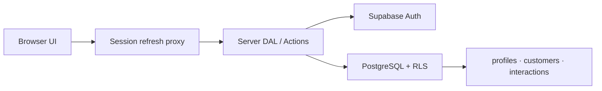

<p align="right">
  <a href="./README.md">한국어</a> · <strong>English</strong>
</p>

# ClientOps CRM

> A bilingual operations CRM for managing customers and interaction history in one place.
>
> Built with Next.js App Router, Supabase Auth/PostgreSQL/RLS, and TypeScript.

[](https://github.com/rhdqngo/clientops-crm/actions/workflows/ci.yml)
[](https://github.com/rhdqngo/clientops-crm/actions/workflows/codeql.yml)
[](LICENSE)


ClientOps is a portfolio CRM for small operations teams to find customers, update their status, and build an interaction history. URL-driven search, filters, and pagination, ADMIN/STAFF authorization, full-filter CSV export, and responsive layouts are connected to a real Supabase data flow.

## Live demo

| Item | URL or account |
| --- | --- |
| 한국어 | <https://clientops-crm-nine.vercel.app/ko/login> |
| English | <https://clientops-crm-nine.vercel.app/en/login> |
| STAFF | `staff.demo@clientops.local` / `ClientOpsDemo!2026` |
| ADMIN | `admin.demo@clientops.local` / `ClientOpsAdmin!2026` |

> This is a public portfolio demo. Do not enter personal data or sensitive interaction details. Demo data resets every day at 3:00 AM KST, and ADMIN users can permanently delete a customer and every linked interaction.

## Key features

- Email/password authentication and protected unauthenticated routes
- `/ko` and `/en` locale URLs with browser detection and remembered user choice
- Operations dashboard with customer status counts and recent interactions
- Name and normalized-phone search, status filters, and 20-item pagination
- Customer creation, editing, status updates, and an append-only interaction timeline
- ADMIN-only permanent customer deletion with cascading interaction deletion
- Locale-aware RFC 4180 CSV export across the complete active search and filter
- A 1440px table, reduced-priority 768px layout, and 390px mobile row list

## Authorization and data protection

| Operation | STAFF | ADMIN |
| --- | --- | --- |
| View, create, and update customers | Allowed | Allowed |
| View and add interactions | Allowed | Allowed |
| Update or delete interactions | Denied | Denied |
| Permanently delete customers and linked interactions | Denied | Allowed |

Authorization does not depend on whether a control is visible in the UI. Every server query and mutation passes through the authentication DAL, and customer deletion rechecks the ADMIN role in the Server Action. PostgreSQL RLS is the final enforcement layer, and no service-role key is present in the application runtime.



- Server timestamps are stored in UTC; the UI and CSV use the `Asia/Seoul` time zone.
- The original phone number and a normalized numeric search value are stored together.
- Anonymous access to public tables is blocked, while authenticated users receive only the policies they need.

## Tech stack

- Next.js 16 App Router, React 19, TypeScript, Tailwind CSS
- Supabase Auth, PostgreSQL 17, Row Level Security
- Zod, Vitest, pgTAP, Playwright
- pnpm 11, Node.js 22, GitHub Actions, Vercel

## Local development

Requirements: Node.js 22+, pnpm 11+, and Docker Desktop.

```powershell
pnpm install --frozen-lockfile
pnpm supabase:start
Copy-Item .env.example .env.local
pnpm dev
```

Read the local API URL and publishable key from `pnpm exec supabase status`, then set them in `.env.local`.

```dotenv
NEXT_PUBLIC_SUPABASE_URL=http://127.0.0.1:54321
NEXT_PUBLIC_SUPABASE_PUBLISHABLE_KEY=<local publishable key>
NEXT_PUBLIC_APP_URL=http://localhost:3000
NEXT_PUBLIC_DEMO_MODE=false
```

To create local ADMIN/STAFF users and sample data, copy `.env.provision.example` to `.env.provision.local` and fill in the private values.

```powershell
pnpm demo:provision
```

Service-role keys and passwords must never be printed or committed, and the service-role key must not be added to the Vercel runtime.

## Verification

```powershell
pnpm lint
pnpm typecheck
pnpm test
pnpm test:db
pnpm test:e2e
pnpm build
```

The current verification baseline includes 24 Vitest tests, 33 pgTAP tests, and 9 Chromium/WebKit E2E tests. Database and E2E tests require a running local Supabase instance and provisioned demo users.

## Project documents

- [Architecture — runtime, data, and security boundaries](docs/architecture.md)
- [Case study — problem, decisions, verification, and trade-offs (Korean)](docs/case-study.md)

## License

[MIT](LICENSE) © 2026 rhdqngo
