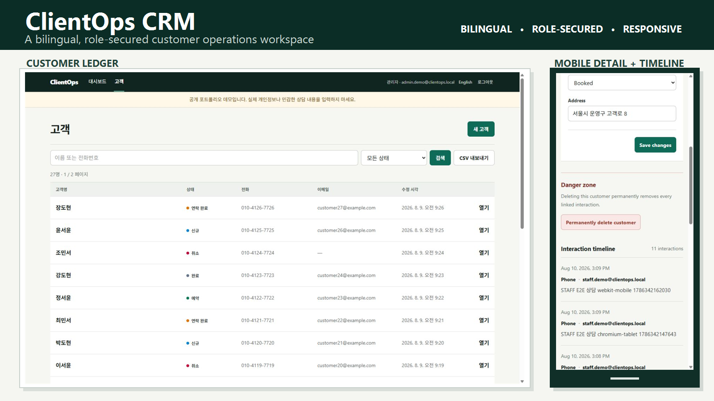
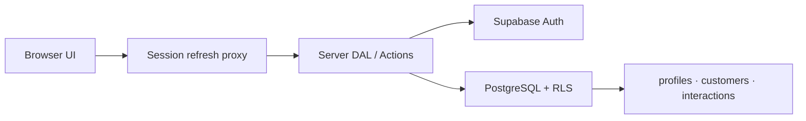

<p align="right">
  <strong>한국어</strong> · <a href="./README.en.md">English</a>
</p>

# ClientOps CRM

> 고객과 상담 기록을 한곳에서 관리하는 한·영 지원 운영형 CRM입니다.
>
> Next.js App Router, Supabase Auth/PostgreSQL/RLS, TypeScript로 구축했습니다.

[](https://github.com/rhdqngo/clientops-crm/actions/workflows/ci.yml)
[](https://github.com/rhdqngo/clientops-crm/actions/workflows/codeql.yml)
[](LICENSE)



ClientOps는 소규모 운영팀이 고객을 검색하고 상태를 갱신하며 상담 이력을 축적하는 포트폴리오 CRM입니다. URL 기반 검색·필터·페이지네이션, ADMIN/STAFF 권한, 필터 전체 CSV, 반응형 화면을 실제 Supabase 데이터 흐름과 연결했습니다.

## 라이브 데모

| 항목 | 주소 또는 계정 |
| --- | --- |
| 한국어 | <https://clientops-crm-nine.vercel.app/ko/login> |
| English | <https://clientops-crm-nine.vercel.app/en/login> |
| STAFF | `staff.demo@clientops.local` / `ClientOpsDemo!2026` |
| ADMIN | `admin.demo@clientops.local` / `ClientOpsAdmin!2026` |

> 공개 포트폴리오 데모입니다. 실제 개인정보나 민감한 상담 내용을 입력하지 마세요. 데모 데이터는 매일 오전 3시(KST)에 초기화되며, ADMIN은 고객과 연결된 상담을 영구 삭제할 수 있습니다.

## 핵심 기능

- 이메일·비밀번호 로그인과 비로그인 보호 경로
- `/ko`, `/en` 언어 URL, 브라우저 언어 감지와 사용자 선택 기억
- 고객 현황과 최근 상담을 보여주는 운영 대시보드
- 이름·정규화 전화번호 검색, 상태 필터, 20건 페이지네이션
- 고객 등록·수정·상태 변경과 append-only 상담 타임라인
- ADMIN 전용 고객 영구 삭제와 연결 상담 기록 cascade 삭제
- 현재 검색·필터 전체 결과를 선택 언어의 RFC 4180 CSV로 내보내기
- 1440px 표, 768px 우선순위 축소, 390px 모바일 행 목록

## 권한과 데이터 보호

| 작업 | STAFF | ADMIN |
| --- | --- | --- |
| 고객 조회·등록·수정 | 허용 | 허용 |
| 상담 조회·추가 | 허용 | 허용 |
| 상담 수정·삭제 | 거부 | 거부 |
| 고객·연결 상담 영구 삭제 | 거부 | 허용 |

권한은 UI 표시 여부에만 의존하지 않습니다. 모든 서버 쿼리와 mutation은 인증 DAL을 통과하고, 고객 삭제는 Server Action에서 ADMIN 역할을 다시 검증합니다. PostgreSQL RLS가 최종 방어선이며 애플리케이션 런타임에는 service-role 키를 두지 않습니다.



- 서버 저장 시간은 UTC, 화면과 CSV의 시간대는 `Asia/Seoul`입니다.
- 전화번호 원문과 검색용 숫자 정규화 값을 함께 저장합니다.
- 공개 테이블은 anon 접근을 차단하고 인증 사용자에게 필요한 최소 정책만 제공합니다.

## 기술 스택

- Next.js 16 App Router, React 19, TypeScript, Tailwind CSS
- Supabase Auth, PostgreSQL 17, Row Level Security
- Zod, Vitest, pgTAP, Playwright
- pnpm 11, Node.js 22, GitHub Actions, Vercel

## 로컬 실행

필수 도구는 Node.js 22+, pnpm 11+, Docker Desktop입니다.

```powershell
pnpm install --frozen-lockfile
pnpm supabase:start
Copy-Item .env.example .env.local
pnpm dev
```

`pnpm exec supabase status`에서 로컬 API URL과 publishable key를 확인해 `.env.local`에 설정합니다.

```dotenv
NEXT_PUBLIC_SUPABASE_URL=http://127.0.0.1:54321
NEXT_PUBLIC_SUPABASE_PUBLISHABLE_KEY=<local publishable key>
NEXT_PUBLIC_APP_URL=http://localhost:3000
NEXT_PUBLIC_DEMO_MODE=false
```

로컬 ADMIN/STAFF 사용자와 샘플 데이터를 만들려면 `.env.provision.example`을 `.env.provision.local`로 복사한 뒤 비공개 값을 채웁니다.

```powershell
pnpm demo:provision
```

service-role 키와 비밀번호는 출력하거나 커밋하지 않으며 Vercel 런타임에도 등록하지 않습니다.

## 검증

```powershell
pnpm lint
pnpm typecheck
pnpm test
pnpm test:db
pnpm test:e2e
pnpm build
```

현재 검증 기준은 Vitest 24개, pgTAP 33개, Chromium/WebKit E2E 9개입니다. DB와 E2E 테스트에는 실행 중인 로컬 Supabase와 provisioning된 데모 사용자가 필요합니다.

## 관련 문서

- [Architecture — 런타임·데이터·보안 구조 (영문)](docs/architecture.md)
- [Case study — 문제, 결정, 검증과 트레이드오프](docs/case-study.md)

## License

[MIT](LICENSE) © 2026 rhdqngo
