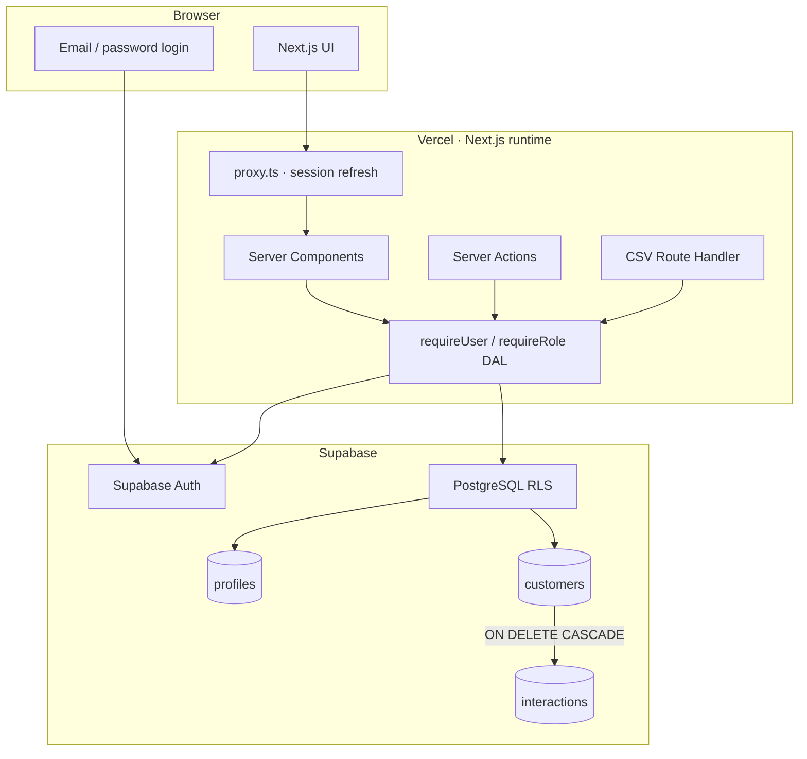
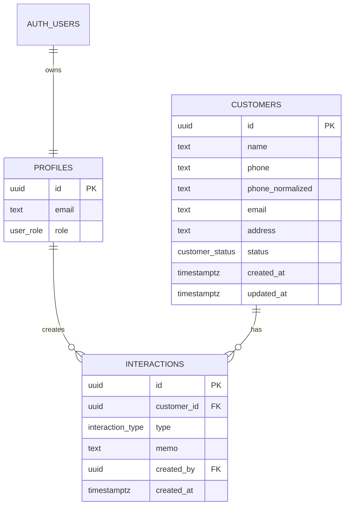

# ClientOps CRM Architecture

## Runtime boundary

`proxy.ts`는 세션 갱신과 비로그인 리다이렉트만 담당합니다. 데이터 접근과 mutation은 서버 DAL을 통과하며 ADMIN 전용 작업은 Server Action에서 역할을 다시 검사합니다. RLS는 우회된 요청에도 동일한 정책을 적용하는 최종 경계입니다.

## Data model

- 상담 기록은 추가·조회만 가능한 append-only 데이터입니다.
- 고객 영구 삭제는 ADMIN에게만 허용되며 상담 기록도 cascade 삭제됩니다.
- 전화 검색은 숫자만 남긴 `phone_normalized`를 사용해 하이픈과 공백 차이를 흡수합니다.
- 목록 RPC는 검색·상태·페이지 검증과 전체 count를 한 요청에서 제공합니다.

## Trust and secret handling

- 브라우저와 Vercel에는 publishable key만 제공합니다.
- service-role 키는 로컬 provisioning 또는 GitHub의 제한된 데모 초기화 작업에서만 사용합니다.
- 공개 signup과 비밀번호 재설정 UI는 제공하지 않습니다.
- `.env.local`, `.env.provision.local`, Supabase 임시 상태는 버전 관리에서 제외합니다.

## Delivery checks

| Layer | Check |
| --- | --- |
| Domain | Zod bounds, enum and UUID validation, phone normalization, pagination, CSV encoding |
| Database | migration, constraints, anon denial, role CRUD, STAFF delete denial, cascade |
| Browser | login, redirect, create/edit/search/filter, interaction append, CSV, role-specific delete |
| Build | ESLint, generated Next types, TypeScript, production build |
